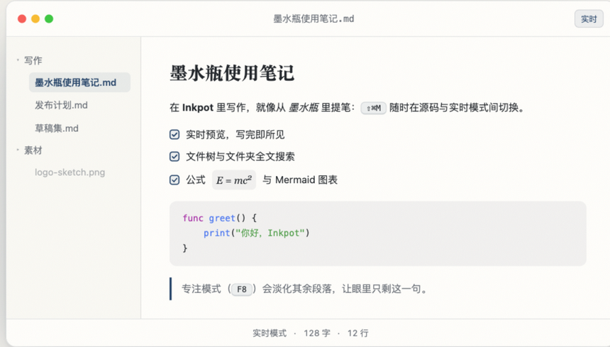

# Inkpot

Inkpot 是面向 macOS 的轻量 Markdown 编辑器。基于 MarkEdit 的成熟实现独立构建，使用 AppKit、WKWebView 与 CodeMirror 6，面向日常中文和 Markdown 写作。

<p align="center"></p>

当前最低系统为 macOS 15。应用名为 Inkpot，Swift 模块名为 `Inkpot`，bundle ID 为 `com.erhu.inkpot`。

- 实时／源码编辑，查找替换、常用格式操作和列表续写。
- 设置窗口（字体字号、默认打开模式、明暗外观、图片文件夹）、标题大纲、文件树、窗口与文件夹恢复和字数统计。
- 代码块按语言着色、本地图片、表格、公式、Mermaid、富文本粘贴以及 HTML／PDF 导出。
- UTF-8 与 BOM、混合行尾保护、关闭前保存确认、外部修改保护、本地恢复草稿与可选自动保存。

使用范围与已知限制见 [功能说明](App/README.md)。

## 下载与安装

**Homebrew**（随首次正式发布启用）：

```bash
brew install --cask funny-dog/tap/inkpot
```

Cask 安装 GitHub 正式 Release 并校验 SHA-256；应用为自签名、未经 Apple 公证，安装后会移除本应用的隔离属性，免去首次打开的手动放行。更新交给 Homebrew 管理：`brew update && brew upgrade --cask inkpot`（应用内「检查更新…」只跳转发布页，不安装更新；曾手动覆盖安装时执行一次升级命令即可对齐版本记录）。卸载与 zap 清理见 [tap 仓库说明](https://github.com/funny-dog/homebrew-tap)。

**DMG／ZIP**：从 [GitHub 最新正式版本](https://github.com/funny-dog/inkpot/releases/latest) 下载，校验 `.sha256` 后安装；仓库私有时需有访问权限的账号。自签名安装首次打开若被拦截，到「系统设置 → 隐私与安全性」点「仍要打开」。升级前正常退出并处理未保存文档，校验安装包后手动覆盖安装。

## 构建与验证

使用仓库携带的 Yarn，不改变系统的 `xcode-select`：

```bash
cd CoreEditor
node .yarn/releases/yarn-4.18.0.cjs install --immutable
node .yarn/releases/yarn-4.18.0.cjs build
node .yarn/releases/yarn-4.18.0.cjs test --runInBand
cd ..
export DEVELOPER_DIR=/Applications/Xcode.app/Contents/Developer
swiftlint lint --strict --config .swiftlint.yml
xcodebuild build -project App/Inkpot.xcodeproj -scheme Inkpot \
  -destination 'platform=macOS' -derivedDataPath build/Debug \
  CODE_SIGN_IDENTITY="" CODE_SIGNING_ALLOWED=NO CODE_SIGNING_REQUIRED=NO
```

原生测试使用同一工程和 scheme，将 `build` 换成 `test`。局部修改用 `-only-testing:InkpotTests/测试类/方法` 定向运行。SwiftLint 使用 0.65.1；CI 的安装来源与校验和固定在工作流中。首次构建 Web 资源后才能构建应用，公式与图表资源全部随应用打包，运行时不需要 CDN。

唯一安装位置为 `/Applications/Inkpot.app`。更新前正常退出旧实例并保留系统未保存提示，安装后移走构建目录中的临时应用副本。不自动改变文件关联。

## 仓库结构

- `App/`：唯一原生应用工程、原生测试与功能说明。
- `CoreEditor/editor/`：当前 Web 编辑器与公式解析器。
- `CoreEditor/test/`：当前编辑器测试；与构建使用相同的官方 CodeMirror 依赖。
- `CoreEditor/scripts/`：离线渲染资源构建。
- `.github/workflows/`：当前应用的构建与验证。

旧 MarkEdit 分叉工程、旧桥接／扩展和重复编辑器已移出当前工程，仅保留当前轻量实现。

Inkpot 保留 [MarkEdit](https://github.com/MarkEdit-app/MarkEdit) 的版权与 MIT 许可；迁入的公式解析器保留 Joplin 来源说明。KaTeX、Mermaid 等第三方资源在构建时携带对应许可。
